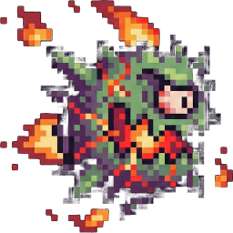

# Enemies

A reference to the enemies currently implemented in the game. Images use the same PNG assets that serve as sprite fallbacks.

| Enemy | Image | Health | Points | Speed | Attacks and traits |
|---|---|---:|---:|---:|---|
| Regular ship (`Regular`) |  | 24 | 240 | 120 | Fires a single aimed projectile about every 2 seconds. |
| Kamikaze (`Kamikaze`) |  | 18 | 180 | 120 | Rushes the player at 180 units per second while tracking the ship and explodes on contact. |
| Interceptor (`Interceptor`) |  | 15 | 150 | 210 | Strafes quickly and fires fast aimed shots about every 2.4 seconds. It uses a separate 3D model. |
| Heavy ship (`Heavy`) |  | 60 | 600 | 75 | Fires a spread of three projectiles about every 3.2 seconds. It uses a separate 3D model. |
| Guardian (`Boss`) |  | 450 | 4,500 | — | Appears in dedicated boss missions, moves around the arena, and fires projectile bursts. Always drops rare metal when destroyed. |

Kamikazes are available from the start, interceptors appear from level 2, and heavy ships from level 4. Every fourth enemy spawn supplies the targeted ship type while an interceptor or heavy-ship objective is still active. The Guardian mission also spawns reinforcements.

Enemy health bars show remaining HP. The speed column gives entry speeds in game units per second. Firing intervals are approximate.
