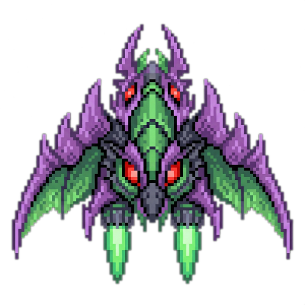
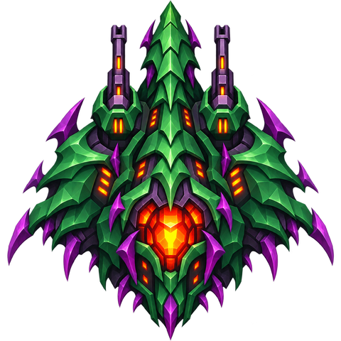

# Enemies

A reference to the enemies currently implemented in the game. PNG previews are shown where a matching image exists; model links point to the 3D assets used in game. The interceptor reuses the regular ship's PNG fallback, and the heavy ship reuses the Guardian's PNG fallback, so those fallback images are not accurate previews of their 3D models.

| Enemy | Image | Health | Points | Speed | Attacks and traits |
|---|---|---:|---:|---:|---|
| Regular ship (`Regular`) |  · [3D model](../assets/models/enemy_regular.glb) | 24 | 240 | 120 | Tracks the nearest visible pilot and fires one aimed projectile about every 2 seconds. |
| Kamikaze (`Kamikaze`) |  · [3D model](../assets/models/enemy_kamikaze.glb) | 18 | 180 | 120 on entry; 180 while chasing | Does not shoot. Turns toward the nearest visible pilot, accelerates to 180 units per second, and explodes on contact. |
| Interceptor (`Interceptor`) | PNG fallback: same as regular · [3D model](../assets/models/enemy_interceptor.glb) | 15 | 150 | 210 | Tracks the nearest visible pilot and fires one fast aimed projectile about every 2.4 seconds. |
| Heavy ship (`Heavy`) | PNG fallback: same as Guardian · [3D model](../assets/models/enemy_heavy.glb) | 60 | 600 | 75 | Fires a three-projectile spread about every 3.2 seconds. |
| Guardian (`Guardian`) |  · [3D model](../assets/models/enemy_guardian.glb) · [damaged model](../assets/models/enemy_guardian_escalated.glb) | 105 | 1,050 | 65 | Fires a five-projectile spread about every 3.6 seconds. Its hull changes appearance at half health. |
| Dreadnought (`Boss`) |  | 600 | 6,000 | — | The boss in mission 5. Adds missiles at two-thirds health and three staggered projectile rings per barrage at one-third. Always drops rare metal. |

Kamikazes are available from the start and interceptors appear from level 2. Heavy ships and Guardians appear from level 4. Guardians account for 5% of random spawns when none is already on the field. Every fourth enemy spawn supplies the targeted ship type while an interceptor or heavy-ship objective is still active.

The Dreadnought telegraphs its cannons with orange firing lines, its missiles with blue launch trails, and its rings with a violet radial warning. Player shots can intercept the missiles. Its cannon volleys occur about every 3 seconds in the opening phase, missile salvos every 2.5 seconds in phase two, and rings every 2 seconds in the final phase.

1. Above 400 HP the Dreadnought fires twin cannon volleys and calls in regular fighters about every 6 seconds.
2. At or below 400 HP it adds homing missiles, calls in interceptors about every 5.25 seconds, and generates a 55 HP shield every 12 seconds.
3. At or below 200 HP it adds three staggered projectile rings per barrage and calls in interceptors and kamikazes together about every 4.5 seconds. Its shield rises to 75 HP and recharges every 8 seconds.

Phase thresholds scale with maximum HP in co-op. The first shield is ready three seconds into phases two and three. Shields expire after four seconds or when their HP runs out.

Enemy health bars show remaining HP. The speed column gives entry speeds in game units per second. Firing intervals are approximate.
