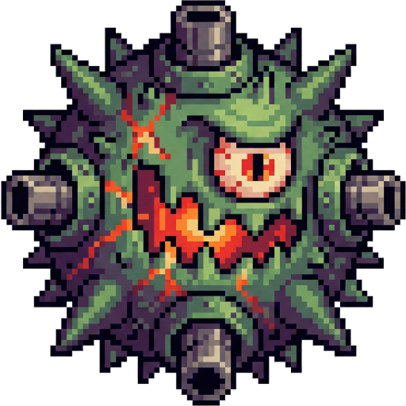

# Enemies

A reference to the enemies currently implemented in the game. Images use the same PNG assets that serve as sprite fallbacks.

| Enemy | Image | Health | Speed | Attacks and traits |
|---|---|---:|---:|---|
| Regular ship (`Regular`) |  | 24 | 120 | Fires a single projectile about every 2 seconds. |
| Kamikaze (`Kamikaze`) |  | 18 | 120 | Does not fire; tries to collide with the player. |
| Interceptor (`Interceptor`) |  | 15 | 210 | Fast ship that fires about every 2.4 seconds. It uses a separate 3D model. |
| Heavy ship (`Heavy`) |  | 60 | 75 | Fires a spread of three projectiles about every 2.2 seconds. It uses a separate 3D model. |
| Guardian (`Boss`) |  | 300 | — | Appears in dedicated boss missions, moves around the arena, and fires projectile bursts. Always drops rare metal when destroyed. |

Regular enemies spawn randomly. Kamikazes are available from the start, interceptors appear from level 2, and heavy ships from level 4. Boss missions contain no regular enemies or asteroids.

Speeds are measured in game units per second. Firing intervals are approximate; exact balance values are defined in the source and may change.
