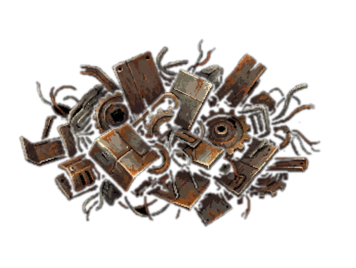
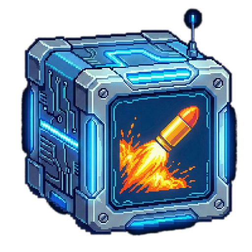
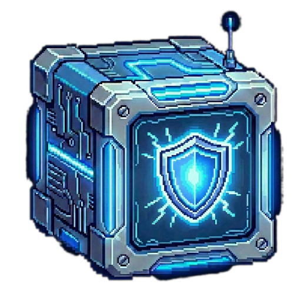

# Loot

A reference to the loot items currently implemented in the game. Images use the same PNG assets that serve as sprite fallbacks.

| Item | Image | Effect |
|---|---|---|
| Scrap (`Scrap`) |  | Common resource used for upgrades. The amount depends on the drop source. |
| Rare metal (`RareMetal`) |  | Rare resource used for major upgrades. |
| Health pack (`HealthPack`) |  | Restores 25 HP up to the ship's current maximum. |
| Rapid fire (`RapidFireBoost`) |  | Triples the firing rate for 10 seconds. |
| Big bullets (`BigBulletBoost`) |  | Increases projectile size and base damage from 15 to 30 for 15 seconds. |
| Magnetic ammo (`MagneticAmmo`) |  | For 10 seconds, newly fired shots home toward nearby enemy ships and bosses ahead of them. |
| Shield (`Shield`) |  | Grants 30–100 shield HP for up to 30 seconds. The shield expires when its HP or timer runs out. |
| Golden shield | The shield pickup has a gold ring. | Grants 30–100 shield HP for up to 60 seconds. The active shield glows gold. |
| Invisibility (`Invisibility`) |  | Cloaks the ship for 10 seconds. Enemy ships stop tracking and firing. Existing shots, collisions, and the Guardian's sweeping volleys can still deal damage. |
| Mystery box (`MysteryBox`) | The in-game crate has a gold ring. | Opens on contact. Each outcome has a 25% chance: restore up to 25 HP, gain 5 rare metal, refresh the shield to at least 45 HP and 30 seconds, or take 20 damage. An active shield absorbs trap damage before the hull takes the rest. |

## Collection

Loot drifts and rotates until it is collected on contact. The ship pulls loot in from within 150 units at base, and Magnet Array upgrades extend that range. The HUD tracks your current scrap and rare metal balances separately from mission progress. Scrap collected during a mission counts toward its scrap objective.

## Drop rates

These are the standard drop rates on Supernova. The standard roll adds 10 on Nebula and subtracts 15 on BlackHole, which shifts the distribution.

| Standard drop | Regular asteroid | Rare asteroid | Enemy ship |
|---|---:|---:|---:|
| Scrap | 40% (1–3) | 15% (5–9) | 30% (5–9) |
| Rare metal | 5% (1) | 30% (2–4) | — |
| Health pack | — | 25% | 25% |
| Rapid fire | — | 18% | 18% |
| Big bullets | — | 12% | 12% |
| Shield | — | — | 8% |
| No standard drop | 55% | — | 7% |

Enemy ships have independent extra rolls for magnetic ammo (8%), invisibility (8%), a mystery box (5%), and a golden shield (2%) on every difficulty. Rare asteroids always drop an item. The Guardian always drops 10–49 rare metal.
