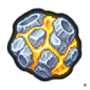
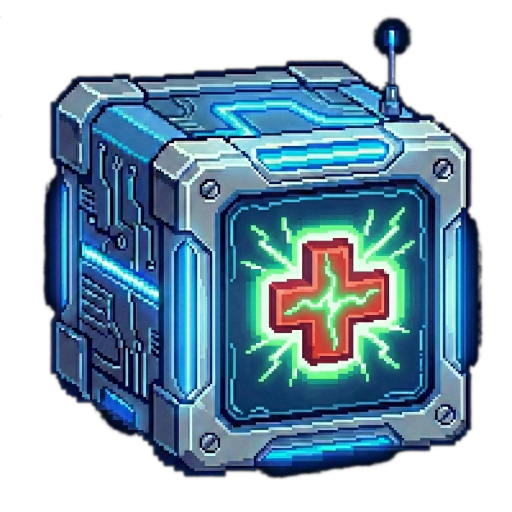
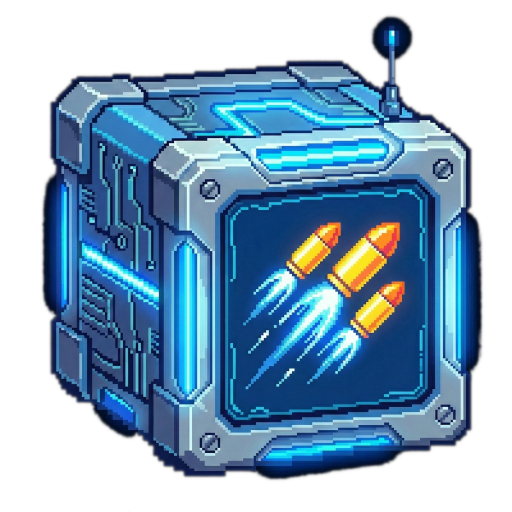
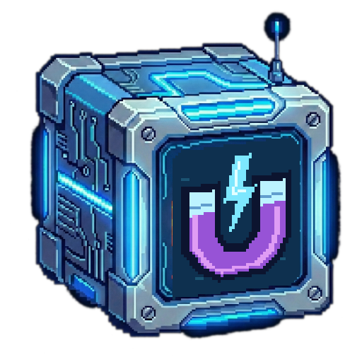
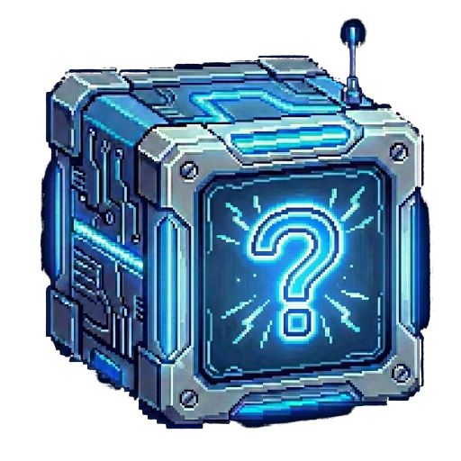

# Loot

A reference to the loot items currently implemented in the game. Images use the same PNG assets that serve as sprite fallbacks.

| Item | Image | Effect |
|---|---|---|
| Scrap (`Scrap`) |  | Common resource used for upgrades. The amount depends on the drop source. |
| Rare metal (`RareMetal`) |  | Rare resource used for major upgrades. |
| Health pack (`HealthPack`) |  | Restores 25 health. |
| Rapid fire (`RapidFireBoost`) |  | Temporarily reduces the interval between shots. |
| Big bullets (`BigBulletBoost`) |  | Temporarily increases projectile damage and size. |
| Magnetic ammo (`MagneticAmmo`) |  | Player projectiles begin homing toward enemies. |
| Shield (`Shield`) |  | Adds a separate durability pool; drops contain 30–100 HP. |
| Invisibility (`Invisibility`) |  | Temporarily makes the ship invisible. |

Loot drop chances vary by source and are modified by the selected difficulty. Destroying a regular enemy can also grant magnetic ammo or invisibility as an extra drop. Rare asteroids always drop an item, and bosses always drop rare metal.
