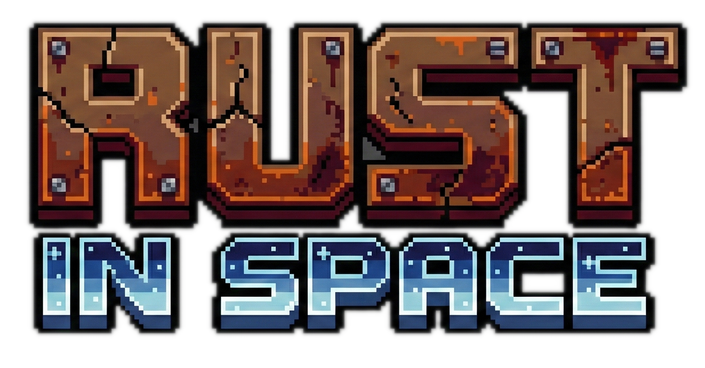

# Rust in Space

  

[English](../../README.md) · [Русский](README.ru.md) · [Deutsch](README.de.md) · **Español** · [日本語](README.ja.md) · [简体中文](README.zh-Hans.md) · [한국어](README.ko.md)

> *Eres piloto mercenario y surcas los confines del espacio civilizado. Aquí, la única ley es la que puedes imponer con los cañones de tu nave. Las corporaciones pagan bien por la chatarra oxidada y los metales raros de los campos de asteroides, pero no te hablan de las patrullas enemigas ni de los piratas espaciales que viven en estos sectores remotos.*
>
> *Cada misión te lleva más adentro de lo desconocido. Cada asteroide que hagas pedazos podría ser el último. Pero pagan bien, y en esta parte de la galaxia eso es lo único que importa. Abróchate el cinturón, piloto. El vacío te espera.*

Juega la campaña de este juego de acción espacial en 2D en solitario o con amigos. Haz pedazos los asteroides, combate contra patrullas enemigas y recoge chatarra y metales raros para mejorar tu nave entre misiones. Elige entre tres niveles de dificultad.

## Descargar y jugar

[**Descargar la última versión**](https://github.com/olegbespalov/rust-in-space/releases/latest)

- **Linux (Intel o AMD de 64 bits)**. Descarga el archivo `.AppImage`, dale permisos de ejecución y ábrelo.
- **macOS**. Descarga `aarch64-apple-darwin.zip` para Apple Silicon o `x86_64-apple-darwin.zip` para Intel. Descomprime el archivo y abre **Rust in Space.app**.

Consulta la [guía de instalación](../installation.md) en inglés para ver las instrucciones de tu plataforma.

## Controles

- **Menú principal**. Usa ↑ / ↓ para elegir una opción, ← / → para cambiar un ajuste y Enter para confirmar. Selecciona **Idioma** para cambiar el idioma del juego.
- **Informe de misión**. Pulsa la barra espaciadora para despegar.
- **En vuelo**. Usa ← / → para girar, ↑ para acelerar y la barra espaciadora para disparar. Pulsa Esc para pausar una partida en solitario.
- **En pausa**. Pulsa Enter para continuar o Esc para volver al menú principal.
- **Tras una misión**. Pulsa Enter para abrir el **Mercado de mercenarios**. Usa ↑ / ↓ para elegir y Enter para comprar una mejora o pasar al siguiente informe.
- **Fin de la partida**. Pulsa Enter para volver al menú principal.

El código fuente actual admite inglés, ruso, alemán, español, japonés, chino simplificado y coreano. Los idiomas disponibles en el juego dependen de la versión.

## Jugar con amigos

Hasta cuatro pilotos pueden jugar la campaña en la misma red local IPv4. Selecciona **Red local** en el menú principal para crear una partida o unirte a ella. Consulta la [guía del modo cooperativo](../local-network.md) en inglés.

## Guías para jugadores en inglés

- [Cómo se juega](../gameplay.md) explica las misiones, la dificultad, el combate y las mejoras de la nave.
- [Enemigos](../enemies.md) y [Botín](../loot.md) detallan los adversarios, los objetos que puedes recoger y la puntuación.
- [Datos guardados](../save-data.md) explica dónde guarda el juego tu récord y tus ajustes.

[Guía de desarrollo en inglés](../development.md) · [Licencia](../../LICENSE)
